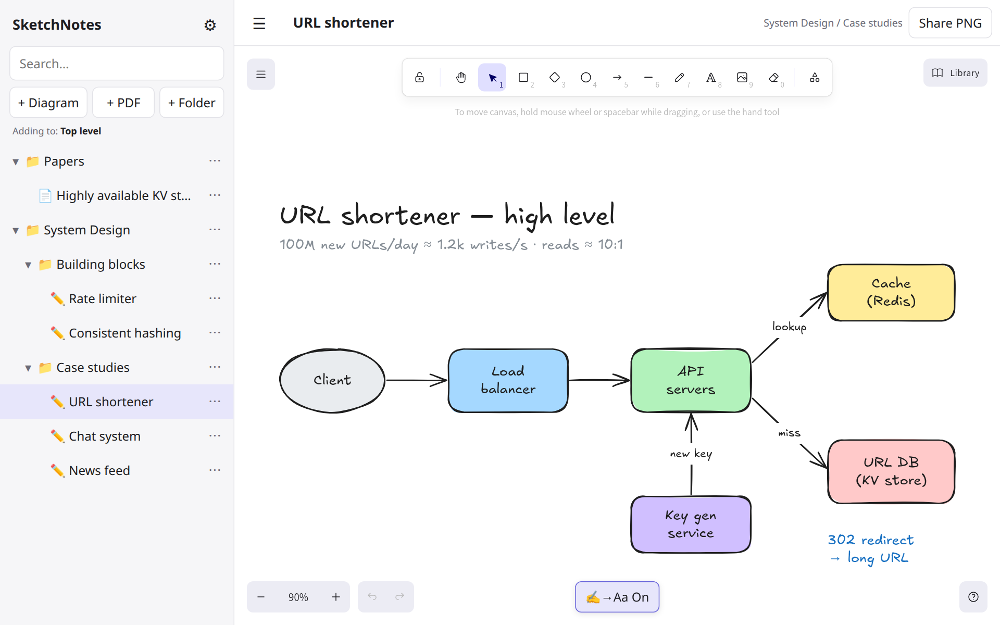
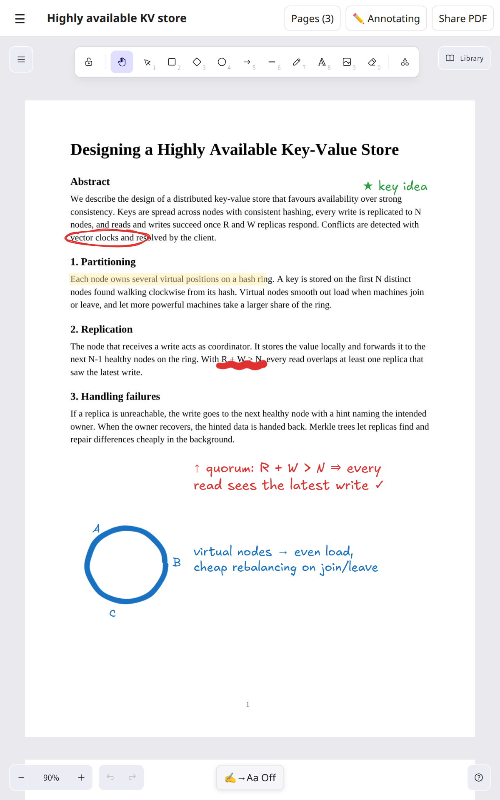
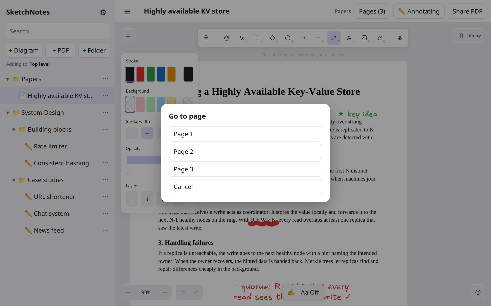
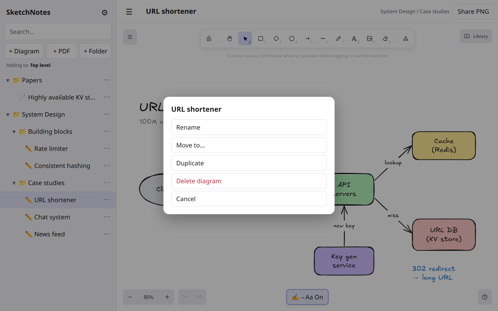
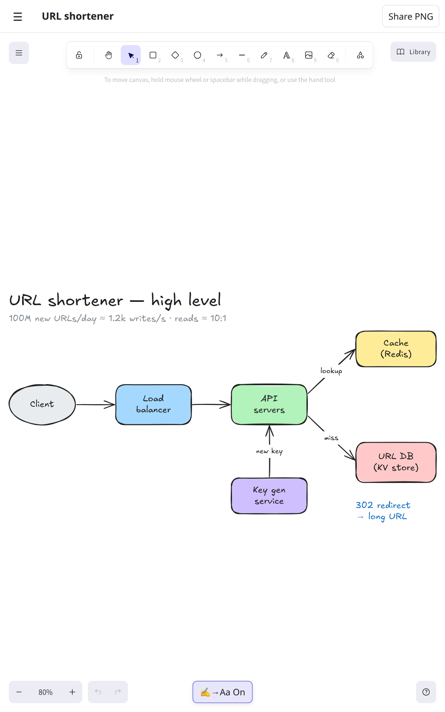
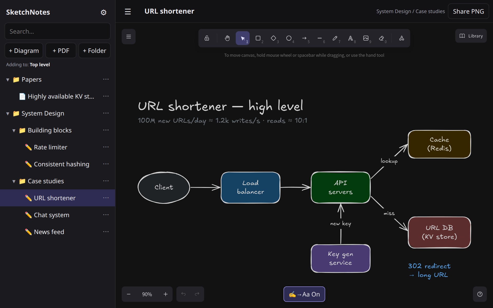

# SketchNotes

An offline, Excalidraw-style diagramming and PDF-annotation app for Android tablets. It's built for system-design interview practice: sketch boxes and arrows with a pen, read and mark up PDFs (papers, books, notes), keep everything in folders, and turn your handwriting into clean text in the Excalidraw font.

SketchNotes wraps the open-source [`@excalidraw/excalidraw`](https://www.npmjs.com/package/@excalidraw/excalidraw) editor in a small React app. [Capacitor](https://capacitorjs.com/) packages it as a native Android APK. Everything stays on the device, and nothing needs an account or a server.

## Features

- **Excalidraw canvas:** the full editor, with shapes, arrows, pencil, text, images, eraser, shape library, undo/redo, grid and dark mode.
- **PDF reading & notes:** import a PDF and write, highlight, draw and type on its pages; export a flattened, annotated copy.
- **Folders:** folders can go inside other folders, with search, rename, move, duplicate and delete.
- **Handwriting → text:** pen writing turns into Excalidraw-font text. Write inside a box and it becomes the box's label. Recognition runs on the device with Google ML Kit.
- **Pen-friendly:** palm rejection, so the pen draws and fingers pan and zoom.
- **Autosave, backups, offline:** everything is stored on the tablet and saved within about half a second. Export a single JSON backup. No account or server.

## A quick tour

### Diagrams for system-design practice

Sketch an architecture with Excalidraw's hand-drawn shapes and arrows. Labels and typed text use **Excalifont**. Keep each design in a folder, and share it as a PNG from the top bar.

<p align="center">
  
</p>

### Read and annotate PDFs

Import a paper or book with **+ PDF**. Its pages appear on the canvas, locked in place. Write in the margins, highlight, circle and type notes, then jump between pages with **Pages**. Switch to **📖 Reading** to scroll without marking the page, or tap **Share PDF** to send a copy with your notes drawn in.

<table>
  <tr>
    <td width="50%"></td>
    <td width="50%" valign="top">
      <p><b>On the page:</b> a highlight, a circled phrase, a red underline, notes in Excalifont, and a sketch of the hash ring. All of it was made with the normal canvas tools.</p>
      <p><b>Go to page:</b></p>
      
    </td>
  </tr>
</table>

### Folders that fit how you study

Folders can go inside other folders. Every folder and item has a **⋯** menu for new items, rename, move, duplicate and delete. The search box filters by title across all folders.

<p align="center">
  
</p>

### Portrait or landscape, light or dark

In portrait the sidebar slides away so the canvas gets the full screen. Dark mode switches both the app and the canvas.

<table>
  <tr>
    <td width="38%"></td>
    <td width="62%"></td>
  </tr>
</table>

<sub>Screenshots were captured from the app's web build at the tablet's resolution (1920×1200 / 1200×1920) using demo content. The UI is the same on the device.</sub>

## Quick start

Prerequisites: Node.js 20+ (developed on 24), JDK 21, the Android SDK (see [docs/development.md](docs/development.md#1-one-time-machine-setup), no Android Studio needed), and a tablet with USB debugging on.

```bash
git clone git@github.com:naamanu/sketchnotes.git
cd sketchnotes
npm install                 # also copies the Excalidraw fonts into public/fonts
echo "sdk.dir=$HOME/Android/Sdk" > android/local.properties

npm run apk                 # type-check, build web assets, sync to Android, assemble debug APK
npm run install-tablet      # adb install -r … (keeps existing data)
```

To change the UI without reinstalling, run `npm run dev` and open the printed URL in a browser. Handwriting recognition is only available in the Android app.

## Documentation

| Doc | What's in it |
|---|---|
| [User guide](docs/user-guide.md) | Every screen and gesture: folders, the canvas, PDFs, handwriting, sharing, backups, settings. |
| [Development](docs/development.md) | Machine setup from scratch, scripts, build and install loop, wireless debugging, release signing. |
| [Architecture](docs/architecture.md) | How the pieces fit: React shell, Excalidraw integration, PDF pipeline, storage, Capacitor bridge, file layout. |
| [Handwriting recognition](docs/handwriting.md) | The native ML Kit plugin, the JS API, and the ink-to-text conversion algorithm, step by step. |
| [Data & backups](docs/data-and-backups.md) | Storage schema, the backup file format, migrations, and what can delete your data. |
| [Troubleshooting](docs/troubleshooting.md) | Build failures, adb problems, recognition issues, and fixes. |

## Tech stack

React 19 · TypeScript · Vite 8 · `@excalidraw/excalidraw` 0.18 · `pdfjs-dist` 6 · `pdf-lib` · `idb-keyval` · Capacitor 8 (`@capacitor/filesystem`, `@capacitor/share`) · Google ML Kit Digital Ink Recognition 19 · Android SDK 36 (min SDK 24).

## Project layout

```
src/
  App.tsx          React shell: sidebar/folder tree, dialogs, diagram editor, menus
  store.ts         Data model + IndexedDB persistence + backup/restore
  ink.ts           JS bridge to the native handwriting plugin + line grouping
  diagramInk.ts    Turns Excalidraw freedraw strokes into Excalifont text elements
  pdf.ts           PDF import (pdf.js → page images) and annotated-PDF export (pdf-lib)
  share.ts         Save a file and open the Android share sheet (download in browsers)
  styles.css       App styles (light/dark themes, safe-area handling)
android/
  app/src/main/java/dev/nana/sketchnotes/
    MainActivity.java   Registers the local Ink plugin
    InkPlugin.java      Capacitor plugin wrapping ML Kit Digital Ink Recognition
docs/              Detailed documentation
```

## License and credits

The canvas is [Excalidraw](https://github.com/excalidraw/excalidraw) (MIT). Its bundled fonts (Excalifont, Virgil, Nunito, Lilita One, Comic Shanns, Cascadia and others) ship under their own licenses inside `@excalidraw/excalidraw`. PDF rendering uses [pdf.js](https://github.com/mozilla/pdf.js) (Apache-2.0), and export uses [pdf-lib](https://github.com/Hopding/pdf-lib) (MIT). Handwriting recognition uses [Google ML Kit](https://developers.google.com/ml-kit/vision/digital-ink-recognition) under the ML Kit terms.
