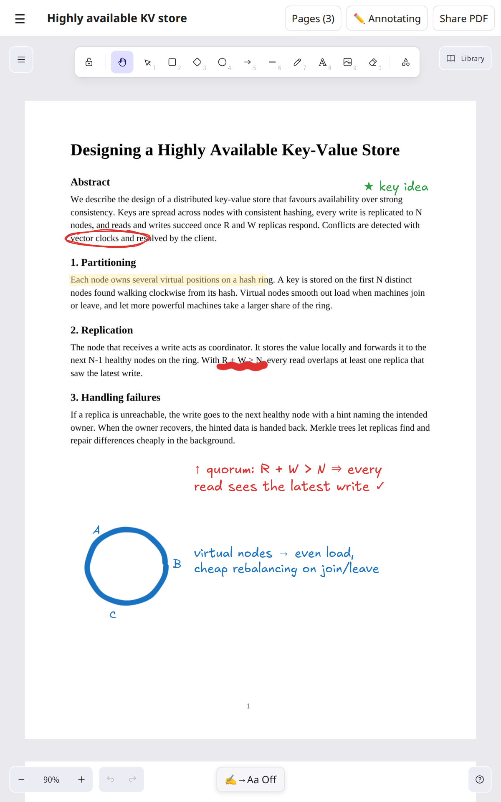

# User guide

This guide covers everything you can do in SketchNotes, screen by screen.

- [The layout](#the-layout)
- [Folders](#folders)
- [Diagrams](#diagrams)
- [Drawing on the canvas](#drawing-on-the-canvas)
- [Reading and annotating PDFs](#reading-and-annotating-pdfs)
- [Handwriting → text](#handwriting--text)
- [Sharing a diagram as PNG](#sharing-a-diagram-as-png)
- [Sharing an annotated PDF](#sharing-an-annotated-pdf)
- [Settings, backups and dark mode](#settings-backups-and-dark-mode)
- [Tips for system-design interviews](#tips-for-system-design-interviews)

---

## The layout

```
┌──────────────────────┬──────────────────────────────────────────────┐
│ SketchNotes      ⚙︎  │ ☰  Diagram title            path  [Share PNG]│  ← top bar
│ [Search…]            ├──────────────────────────────────────────────┤
│[+Diagram][+PDF][+Fol]│                                              │
│ Adding to: Top level │            Excalidraw canvas                 │
│ ▾ 📁 System Design ⋯ │                                              │
│     ✏️ URL shortener⋯│                                              │
│   ▸ 📁 Practice    ⋯ │                                              │
│ 📄 Dynamo paper    ⋯ │                    [✍️→Aa On]                │  ← handwriting toggle
└──────────────────────┴──────────────────────────────────────────────┘
        sidebar                         editor
```

- **Sidebar:** your folders and diagrams. Tap **☰** in the top bar to show or hide it.
  - **Landscape or wide screens (900 CSS px and up):** the sidebar sits beside the canvas.
  - **Portrait or narrow screens:** it slides over the canvas. Tap the dimmed area or pick a diagram to close it. If a diagram was open when you last left the app, it opens straight to the canvas.
- **Top bar:** the open item's title, which you can edit by tapping it, and its folder path (hidden on narrow screens). Diagrams have **Share PNG**. PDFs have **Pages**, **✏️ Annotating / 📖 Reading** and **Share PDF**.
- **Editor:** the Excalidraw canvas for the open diagram.

The app remembers which diagram was open, which folders were expanded, and your theme between launches.

## Folders

Folders can go inside other folders, to any depth.

| To… | Do this |
|---|---|
| Create a top-level folder | Make sure *Adding to* says **Top level** (tap **reset** if not), then tap **+ Folder**. |
| Create a subfolder | Tap **⋯** on a folder → **📁 New subfolder**. Or tap the folder (so *Adding to* shows it), then **+ Folder**. |
| Expand / collapse | Tap the folder name. |
| Rename | **⋯** → **Rename**. |
| Move | **⋯** → **Move to…**, then pick a destination. A folder can't be moved into itself or its own subfolders, so those aren't offered. |
| Delete | **⋯** → **Delete folder**. The confirmation says how many subfolders and diagrams will be deleted with it. **This can't be undone**, so export a backup first if unsure. |

### "Adding to"

The line under the buttons shows where **+ Diagram** and **+ Folder** will create things. Tapping a folder makes it the target. Opening a diagram makes that diagram's folder the target. Tap **reset**, or the empty space below the tree, to go back to **Top level**.

### Sorting and search

Folders are sorted alphabetically, and diagrams by most recently edited. Typing in **Search…** filters diagrams and PDFs by title (case-insensitive) and expands every folder so matches are visible.

## Diagrams

| To… | Do this |
|---|---|
| Create | **+ Diagram** (in the *Adding to* folder), or folder **⋯** → **✏️ New diagram here**. Name it and tap OK. |
| Open | Tap it in the sidebar. |
| Rename | Tap the title in the top bar and type, or **⋯** → **Rename**. |
| Move | **⋯** → **Move to…**. |
| Duplicate | **⋯** → **Duplicate**. This makes a "(copy)" in the same folder, which is useful as a template. |
| Delete | **⋯** → **Delete diagram**, then confirm. This can't be undone. |

Diagrams save automatically. There is no save button.

> **Upgrading from an older version?** Earlier builds also had plain-text notes. These now open as diagrams with your text placed on the canvas as one Excalifont text block, so nothing is lost.

## Drawing on the canvas

The canvas is the standard Excalidraw editor. A quick reference:

**Toolbar (top):** lock tool · hand (pan) · select · rectangle · diamond · ellipse · arrow · line · pencil (freedraw) · text · image · eraser · more tools.

**Pen vs finger.** The first time Excalidraw sees a stylus it switches to *pen mode*. After that:
- The **pen** uses the selected tool.
- **One finger** pans the canvas, and **two fingers** pinch-zoom. Your palm won't draw.

To use your finger for drawing again, turn pen mode off in Excalidraw's menu (☰ in the top-left of the canvas).

**Useful moves:**
- **Label a shape:** double-tap a rectangle, ellipse or diamond and type. The text is centred inside the shape and moves with it.
- **Connect shapes:** draw an arrow from one shape to another. It snaps to their edges and stays attached when you move them.
- **Style:** select something to open the properties panel (stroke colour, fill, stroke width, sloppiness, edges, font size, opacity, layers).
- **Library:** **Library** (top-right) holds reusable shapes. Select shapes and add them to build your own kit.
- **Undo / redo:** the arrow buttons at the bottom-left.
- **Zoom:** **−** / **+** at the bottom-left; tap the percentage to reset.
- **Canvas menu (☰ top-left):** background colour, clear canvas, theme, grid, zen mode, view mode, help. (Excalidraw's own *open / save / export image* entries are hidden because they don't work inside an Android app. Use **Share PNG** and **Backups** instead.)

New text always starts in **Excalifont**, the hand-drawn Excalidraw font. You can still change the font of selected text in the properties panel.

## Reading and annotating PDFs

A PDF opens on the same Excalidraw canvas as a diagram, with its pages stacked top to bottom. Everything you can do on a diagram works on top of the pages.



### Importing

1. Tap **+ PDF** in the sidebar, or folder **⋯** → **📄 Import PDF here**.
2. Pick a file in the Android file picker (Downloads, Drive, Files and so on).
3. Confirm the name, which defaults to the file name.
4. Wait while *"Preparing pages… n / total"* runs. Each page is turned into an image once, at about 150 dpi. A 30-page paper takes a few seconds.

The PDF appears in the sidebar with a 📄 icon and opens on page 1, fitted to the screen, with the **pencil already selected**.

### Reading

- **Scroll:** drag with one finger. Once you've used the pen, a finger always pans; otherwise, pick the hand tool or switch to reading mode.
- **Zoom:** pinch, or use **−** / **+** at the bottom-left.
- **Pages (n):** tap it in the top bar and pick a page to jump there.
- **✏️ Annotating ↔ 📖 Reading:** reading mode is Excalidraw's view mode. Touches only scroll and zoom, so you can't mark the page by accident. Tap again to go back to annotating. Each PDF opens in annotating mode.
- The app remembers where you were in each PDF.

### Taking notes

The pages are **locked**: they can't be selected, moved or erased. So you can scribble freely and erase only your own notes.

| To… | Use |
|---|---|
| Write by hand | **Pencil** (selected when the PDF opens). |
| Highlight | **Pencil** with a thick stroke, a yellow or green stroke colour, and **opacity** around 30–40 %. Or draw a **rectangle** with a solid fill colour at low opacity over a passage. |
| Type a note | **Text** tool (Excalifont). |
| Box, circle or underline something | Rectangle, ellipse, line and arrow tools. |
| Remove a note | **Eraser**, or select it and delete. The page underneath is untouched. |
| Write in the margins | Just write. The canvas carries on past the page edges, but see the export note below. |

**Handwriting → text** works here too, but for PDFs it's **off by default**, since notes on a page are usually meant to stay as ink. The **✍️→Aa** toggle at the bottom is remembered separately for PDFs and diagrams.

### Sizes and storage

Each page is stored as a JPEG of about 150–400 KB, so a 100-page book adds around 20–40 MB to the app's storage. This is saved once at import; later autosaves only write your notes. Very long PDFs (hundreds of pages) work, but take longer to import and to back up.

## Handwriting → text

SketchNotes can read your pen writing and replace it with real text in Excalifont.

### Automatic mode (default)

1. Pick the **pencil** tool.
2. Write a word or a short phrase.
3. Lift the pen and wait about a second. A small **"Converting handwriting…"** label appears, and then your ink is replaced by text.

How the result is placed:
- **Size:** the text matches the height of your writing, snapped to one of Excalidraw's sizes (16, 20, 28, 36, 48, 64 or 96).
- **Colour:** the text uses the colour of your ink.
- **Lines:** several lines written in one go become one text element per line, placed where each line was.
- **Inside a box:** handwriting written inside an empty rectangle, ellipse or diamond becomes that shape's centred label (capped at size 36). It then moves with the shape, exactly like typing a label. If several lines go into the same box, they become a multi-line label.

If a line can't be read, its ink is left alone and you'll see *"Couldn't read that — left it as ink"*.

**Didn't want it converted?** Tap **undo**: one undo puts the original ink back. Your strokes aren't converted again after that.

**Sketching freehand?** Turn auto-conversion off with the **✍️→Aa On/Off** button at the bottom-centre of the canvas. The setting is remembered.

### Manual mode

With auto-conversion **off**:
1. Write with the pencil.
2. Switch to the select tool and select the ink, either by dragging a selection box or tapping strokes.
3. Tap **Aa Convert selection** at the bottom-centre.

Strokes drawn while auto-conversion was off are never converted automatically later. Only strokes drawn while it's on are.

### First use

Recognition runs entirely on the tablet using Google's ML Kit. The **first time** you use it, the app downloads the English handwriting model (about 20 MB), so **the tablet needs internet that one time**. After that it works offline.

### Getting good results

- Write each word or phrase in **one go**, then pause. The pause is what triggers recognition.
- Keep a line roughly level. Lines are told apart by vertical position, so writing on a steep slant can merge or split them.
- Print or join letters as you like; ML Kit handles both. Very small writing is harder to read.
- Dots on *i* and *j* and apostrophes are attached to the nearest line automatically.
- To label a box, write **inside** it, and keep the middle of your writing inside the box's edges.

More detail on how this works: [handwriting.md](handwriting.md).

## Sharing a diagram as PNG

Tap **Share PNG** in the top bar. The app renders the whole diagram with a 24 px margin and a background (dark if you're in dark mode). The Android share sheet then opens, so you can send it to Gmail, Drive, Messages, Files and so on. The file is named after the diagram title.

## Sharing an annotated PDF

In a PDF, tap **Share PDF**. Each page is flattened together with the notes drawn on it into a new PDF, at the original page sizes and named *"Title (annotated).pdf"*. The share sheet then opens. A progress label shows *"Exporting page n / total…"*.

- Notes are included on any page they **overlap**, and are clipped to that page's edges. Anything drawn entirely in the gap between pages or off to the side is left out.
- Pages are exported as images, so the text in the exported PDF can't be selected or searched. Your original PDF file is not modified.

## Settings, backups and dark mode

Tap **⚙︎** at the top of the sidebar.

| Option | What it does |
|---|---|
| **🌙 Dark mode / ☀️ Light mode** | Switches the app and canvas theme. The first launch follows the system setting; after that your choice is remembered. |
| **⬆️ Export backup** | Packs every folder, diagram and PDF (page images and notes included), plus images pasted into diagrams, into one `sketchnotes-backup-YYYY-MM-DD-HH-MM.json` file and opens the share sheet. Save it to Drive, Files or email. |
| **⬇️ Import backup** | Pick a backup `.json` file. Its folders and diagrams are **merged** into the current data. Items with the same internal id are overwritten by the backup's version, and everything else is kept. |

> Your diagrams live **only on this tablet** until you export a backup. Uninstalling the app or using *Clear storage* in Android settings deletes them. See [data-and-backups.md](data-and-backups.md).

## Tips for system-design interviews

- Import papers you're studying (Dynamo, Bigtable, Raft, Kafka…) as PDFs and annotate them next to your diagrams.
- Make a **System Design** folder, with subfolders per topic (*Storage*, *Messaging*, *Case studies*).
- Build a **template** diagram with the boxes you always draw (client, load balancer, API service, cache, DB, queue). **Duplicate** it for each new problem.
- Add frequently used components to the **Library** so you can drag them in.
- Use **handwriting → text** to label boxes quickly: draw a rectangle with the rectangle tool, switch to the pencil, and write the name inside it.
- Use colour to separate request paths from async flows.
- Turn on the **grid** (canvas menu) for tidier layouts.
- When you're done, **Share PNG** to send it to yourself or an interviewer.
